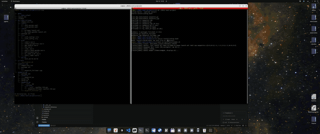

# ROS2-nav2-project

Автономный мобильный робот на ROS 2 Humble: проезд из точки А в точку Б
по waypoints с объездом препятствий в симуляторе Gazebo Classic.
Стек — Nav2 + slam_toolbox, сенсоры — 2D лидар, depth-камеры (эмуляция
Orbbec Astra), ультразвуковые дальномеры, GPS, IMU. Целевое железо —
Raspberry Pi 5.



## Стек

- **ROS 2 Humble** (Ubuntu 22.04)
- **Gazebo Classic** + `gazebo_ros_pkgs`
- **Nav2** — планирование пути и управление (`nav2_bringup`)
- **slam_toolbox** — SLAM в режиме mapping (TF `map → odom`)
- **rviz2** — визуализация
- **waypoint_py / waypoint_cpp** — узлы-обходчики waypoints (Python и C++)

## Железо (целевое)

| Компонент | Модель / интерфейс |
|---|---|
| Вычислитель | Raspberry Pi 5 |
| Лидар | 360°, 15 Гц (`/scan_lidar`) |
| Камеры | Orbbec Astra × 2 (передняя + задняя, depth) |
| IMU | 100 Гц (`/imu/data`) |
| Дальномеры | HC-SR04 × 3 (front, left, right) |
| GPS | NMEA-модуль (UART) |
| Привод | Дифференциальный: 2 ведущих колеса + кастер |

## Структура репозитория

```text
src/  
├── my_robot_bringup # URDF, launch, config, rviz, worlds  
│ ├── config/  
│ │ ├── nav2_params.yaml # Nav2 + AMCL  
│ │ └── slam_params.yaml # slam_toolbox  
│ ├── launch/  
│ │ ├── my_robot_gazebo.launch.xml # Gazebo + SLAM + RViz  
│ │ └── bringup.launch.xml # всё сразу + waypoints  
│ ├── rviz/  
│ │ └── urdf_config.rviz  
│ ├── urdf/ # модульные xacro  
│ │ ├── my_robot.urdf.xacro  
│ │ ├── mobile_base.xacro  
│ │ ├── mobile_base_gazebo.xacro  
│ │ ├── lidar.xacro  
│ │ ├── camera.xacro  
│ │ ├── imu.xacro  
│ │ ├── gps_module.xacro  
│ │ ├── sonic_radar.xacro  
│ │ └── common_properties.xacro  
│ └── worlds/  
│ └── test_world.world  
├── waypoint_py # Python-обходчик waypoints (ament_python)  
│ └── waypoint_py/waypoint_follower.py  
├── waypoint_cpp # C++-обходчик waypoints (ament_cmake)  
│ └── src/waypoint_follower.cpp  
├── scripts/  
│ └── record_demo.sh # запуск + rosbag + видео  
├── data/demo_output/ # артефакты прогонов (видео, bag)  
└── README.md  
```

## Зависимости

- ROS 2 Humble: `ros-humble-desktop`, `ros-humble-nav2-bringup`,
  `ros-humble-slam-toolbox`, `ros-humble-gazebo-ros-pkgs`,
  `ros-humble-xacro`, `ros-humble-robot-state-publisher`
- Системные: `ffmpeg` (для записи видео), `python3-colcon-common-extensions`

Установка (Ubuntu 22.04):
```bash
sudo apt install ros-humble-desktop ros-humble-nav2-bringup \
  ros-humble-slam-toolbox ros-humble-gazebo-ros-pkgs ros-humble-xacro \
  python3-colcon-common-extensions ffmpeg
```
Сборка
```bash
cd ~/ROS2-nav2-project
colcon build --symlink-install
source install/setup.bash
```

Быстрый старт (одной командой)
```bash
cd ~/ROS2-nav2-project
source install/setup.bash
ros2 launch my_robot_bringup bringup.launch.xml
```

Что происходит:

- Поднимается Gazebo Classic с test_world.world.
- Спавнится робот my_robot в точке (0, 0, 0.1).
- robot_state_publisher публикует TF.
- slam_toolbox строит карту по /scan_lidar.
- nav2_bringup/navigation_launch.py поднимает Nav2 (без AMCL — SLAM даёт map → odom).
- Через 15 с стартует waypoint_follower (Python по умолчанию) и последовательно проходит waypoints.

Launch-аргументы
```bash
# C++-узел вместо Python
ros2 launch my_robot_bringup bringup.launch.xml impl:=cpp

# Свои waypoints
ros2 launch my_robot_bringup bringup.launch.xml \
  waypoints:="[0.0,0.0, 3.0,-2.0, 7.0,2.0, 10.0,0.0]"
```

Топики

| Топик | Тип | Источник |
|---|---|---|
| `/scan_lidar` | `sensor_msgs/LaserScan` | лидар 360°, 15 Гц |
| `/map` | `nav_msgs/OccupancyGrid` | slam_toolbox |
| `/odom` | `nav_msgs/Odometry` | diff_drive_controller |
| `/cmd_vel` | `geometry_msgs/Twist` | Nav2 / velocity_smoother |
| `/plan` | `nav_msgs/Path` | planner_server |
| `/local_plan` | `nav_msgs/Path` | controller_server |
| `/depth_camera/points` | `sensor_msgs/PointCloud2` | depth-камера (спереди) |
| `/depth_camera_rear/points` | `sensor_msgs/PointCloud2` | depth-камера (сзади) |
| `/imu/data` | `sensor_msgs/Imu` | IMU |
| `/gps/fix` | `sensor_msgs/NavSatFix` | GPS-модуль |
| `/front_ultrasonic/range` | `sensor_msgs/Range` | HC-SR04 (front) |
| `/left_ultrasonic/range` | `sensor_msgs/Range` | HC-SR04 (left) |
| `/right_ultrasonic/range` | `sensor_msgs/Range` | HC-SR04 (right) |

TF-дерево

```text
map
└── odom
    └── footprint_link
        └── base_link
            ├── camera_link
            ├── camera_rear_link
            ├── lidar_link
            ├── imu_link
            ├── gps_link
            ├── front_ultrasonic_link
            ├── left_ultrasonic_link
            ├── right_ultrasonic_link
            ├── left_wheel_link
            ├── right_wheel_link
            └── caster_wheel_link
```

Waypoints  
Задаются как плоский список [x1, y1, x2, y2, ...] в системе map.  
Формат одинаков для Python- и C++-узлов. Передаются через  
launch-аргумент waypoints или через --ros-args -p.  

Лицензия  
Apache-2.0  